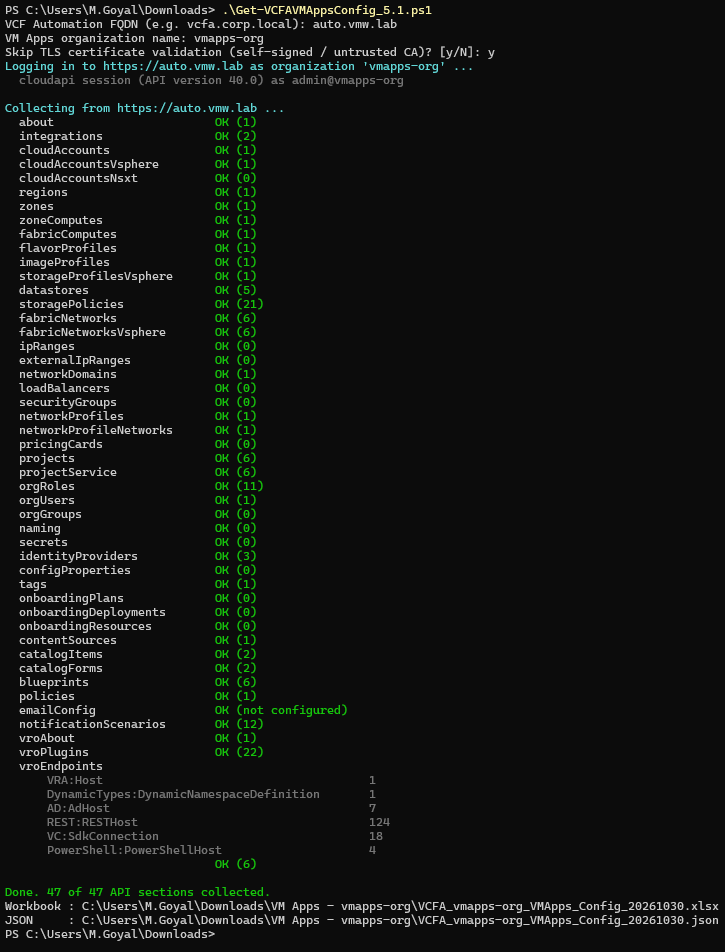

# VCF Automation – VM Apps Configuration Workbook Generator

A read-only PowerShell script that connects to a **VCF Automation 9.x VM Apps organization** and captures its full configuration into a readable Excel workbook, plus a raw JSON dump for quick reference.

It replaces filling in the VM Apps configuration workbook by hand from the UI.



## What it captures

| Sheet | Contents |
|---|---|
| **Index** | Run details (org, FQDN, time, user, login method) and a linked table of contents with item counts |
| **Version** | Version history row for the run |
| **Infrastructure** | Integrations, cloud accounts and site associations, cloud zones and their compute, flavor and image mappings, storage profiles, compute, networks, IP ranges, load balancers, network domains, security groups, datastores, pricing cards |
| **Administration** | Projects (zones, limits, constraints, custom properties, users and groups), organization roles, users and groups, custom names, secrets (names only), settings, identity providers (OIDC / LDAP / SAML) |
| **Infra - Network Profiles** | Network profiles and the networks in each profile |
| **Tags** | Every tag (key:value), whether it is a capability or resource tag, where it is used, and which constraints reference it |
| **Onboarding** | Onboarding plans, deployments and resources |
| **Content & Policies** | Content sources, catalog items (custom request form status), cloud templates, all policy types, email server, notification scenarios |
| **Orchestrator** | Every configured plug-in endpoint in the vRO inventory (AD, REST, PowerShell, vCenter, VRA host, SSH, Dynamic Types, …) with all their attributes |
| **Collection Log** | One line per API call: status, item count, error message, duration |

Layout: objects with a handful of instances are shown side by side (#1, #2, …). Above 10 objects (configurable), a section switches to one row per object.

## Requirements

- Windows PowerShell **5.1** or PowerShell **7+** (Windows, macOS or Linux)
- HTTPS access to the VCF Automation FQDN
- No modules needed: the `.xlsx` is written natively (no Excel or ImportExcel required)
- An org account with these roles (read access is all the script uses):
  - **Assembler** Administrator – infrastructure, projects, cloud templates
  - **Service Broker** Administrator – catalog, policies, notifications
  - **Orchestrator** Administrator – vRO inventory

  Without them most calls return HTTP 403 even though login succeeds.

## Usage

```powershell
.\Get-VCFAVMAppsConfig.ps1
```

It asks for the FQDN, organization, whether to skip TLS validation, and credentials (`@<org>` is appended to the user name automatically).

Output goes to a per-org folder (`All Apps` and `Provider` collectors will use their own prefixes):

```
VM Apps - <org>\VCFA_<org>_VMApps_Config_<yyyyMMdd>.xlsx
VM Apps - <org>\VCFA_<org>_VMApps_Config_<yyyyMMdd>.json
```

Existing files are never overwritten; a second run on the same day gets `_v2`, `_v3`, …

### Parameters

| Parameter | Purpose |
|---|---|
| `-Server`, `-Organization`, `-Credential` | Skip the prompts |
| `-SkipCertificateCheck` | Accept self-signed / untrusted certificates |
| `-UseApiToken` | Log in with an organization API token instead of a user name and password |
| `-OutputFolder` | Parent folder for the `VM Apps - <org>` folder (default: current folder) |
| `-FromJson <file>` | Rebuild the workbook from a saved JSON, no connection needed |
| `-MaxColumns <n>` | Side-by-side limit before a section switches to rows (default 10) |
| `-OnlyUsedNetworks` | In the Networks table, list only networks that are in a profile, have a CIDR or have an IP range |
| `-SkipFormCheck` | Skip the per-catalog-item custom form lookup (large catalogs) |

### Hard-coding inputs

The `$Preset` block at the top of the script can hold the FQDN, organization, TLS choice and user name, so the script only asks for what is left empty. Prefer an encrypted credential file over a plain-text password:

```powershell
Get-Credential | Export-Clixml -Path C:\path\vcfa-cred.xml   # then set CredentialFile in $Preset
```

Only the same Windows user on the same machine can decrypt that file.

## Behaviour on large environments

- Pages through every list API, following the server's own totals. A short result is flagged **PARTIAL** in the Collection Log instead of being silently truncated.
- Retries throttling and 5xx errors with backoff, and logs in again automatically if the session expires mid-run.
- One failing section never stops the rest; it is reported in the Collection Log.

## Security

- Read-only: only `GET` calls, plus the login `POST`.
- Passwords are never returned by the APIs. Any field that looks like a password, secret, token or private key is redacted before the JSON is written.
- The generated workbook and JSON can contain customer infrastructure details; `.gitignore` keeps them out of this repository.

## Execution policy

If Windows refuses to run the script:

```powershell
Set-ExecutionPolicy -Scope Process -ExecutionPolicy Bypass
Unblock-File .\Get-VCFAVMAppsConfig.ps1
```

If it is blocked by **Software Restriction Policies** or an enforced Group Policy, do not work around it on a customer machine. Run it from another machine that can reach VCF Automation, or ask the customer's IT for an exception or to sign the script.
